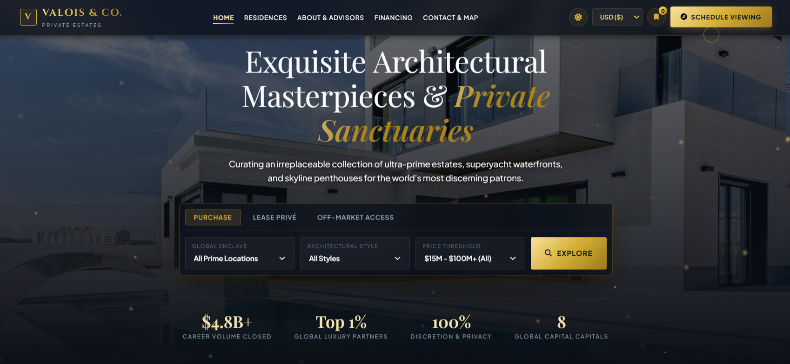
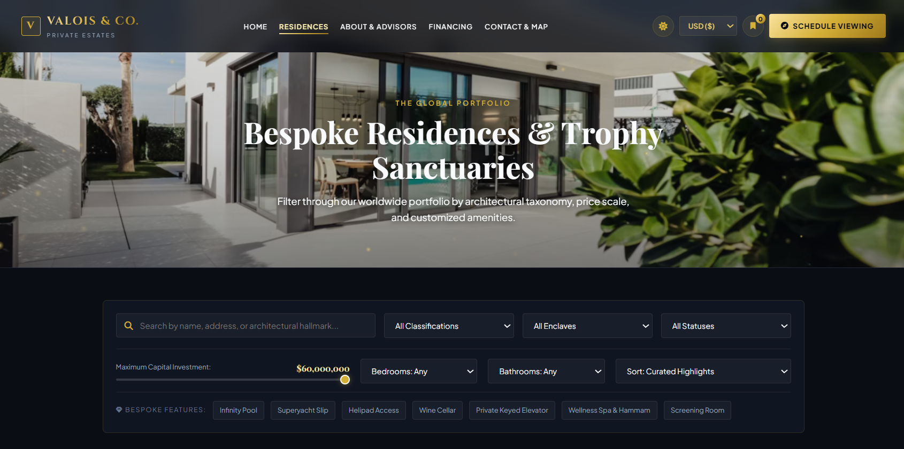
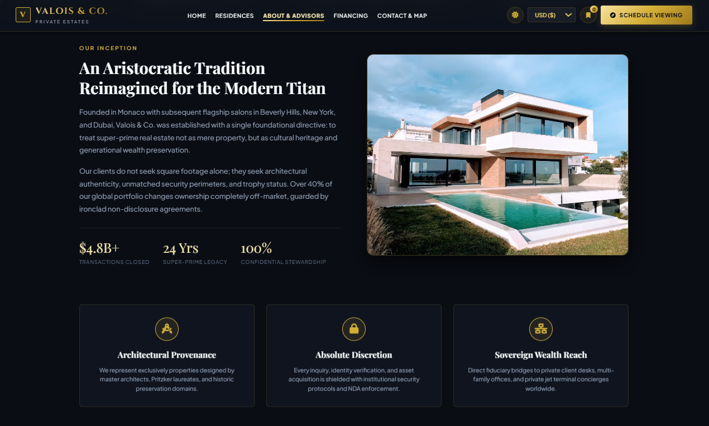
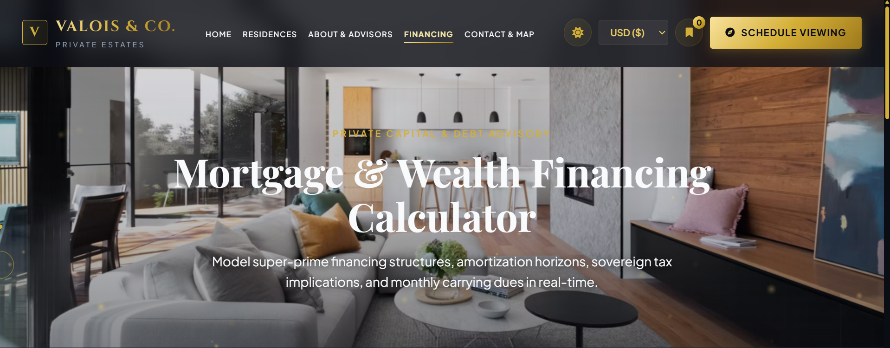
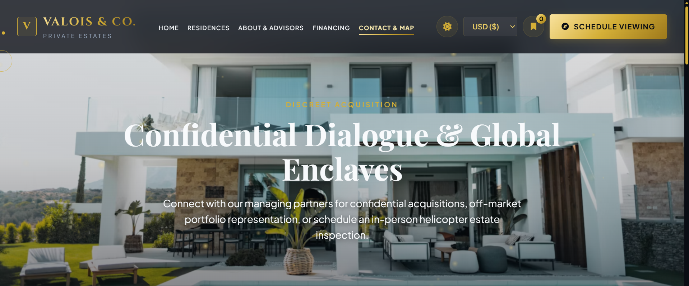

# VALOIS & CO. Private Estates

<p>
  <strong>A Refined Digital Experience for Luxury Real Estate</strong>
</p>

---

## About The Project

**VALOIS & CO. — Private Estates** is a premium real estate website concept designed to showcase exceptional residences, exclusive properties, and luxury real estate services through an elegant, modern, and sophisticated digital experience.

The website combines refined typography, immersive visuals, responsive layouts, and interactive elements to create a professional online presence for a luxury property brand.


## Website Screenshots

### Home Page


### Residences


### About Us


### Financing Calculator


### Contact Page



## Pages & Sections

- **Home:** An elegant introduction to the brand with featured properties and luxury-focused visuals.
- **About:** Information about the company's story, vision, and approach to luxury real estate.
- **Residences:** A showcase of selected properties and exclusive estates.
- **Financing Calculator:** An interactive tool for exploring property financing and mortgage estimates.
- **Contact:** Contact information and an interactive map experience.

## Key Features

- Premium luxury real estate design
- Modern and elegant user interface
- Responsive layouts for desktop, tablet, and mobile
- Dedicated pages for property listings and company information
- Interactive financing calculator
- Property and advisor data managed through JavaScript
- Interactive map experience
- Smooth animations and visual effects
- Reusable CSS styling
- External font and icon integration

## Technologies Used

| Technology | Purpose |
|---|---|
| HTML5 | Website structure |
| CSS3 | Styling, layouts, responsiveness, and animations |
| JavaScript | Interactivity and dynamic functionality |
| Google Fonts | Typography |
| Font Awesome | Icons |
| Leaflet | Interactive maps |

## Project Structure

```text
valois-and-co/
│
├── index.html
├── about.html
├── properties.html
├── calculator.html
├── contact.html
│
├── css/
│   ├── style.css
│   ├── responsive.css
│   ├── animations.css
│   └── pro-motion.css
│
├── js/
│   ├── app.js
│   ├── agents-data.js
│   ├── properties-data.js
│   ├── calculator.js
│   ├── map.js
│   ├── theme-init.js
│   ├── pm-boot.js
│   └── pro-motion.js
│
└── screenshots/
    ├── home.png
    ├── residences.png
    ├── about.png
    ├── financing.png
    └── contact.png
```

## Getting Started

### Run Locally

1. Clone this repository:

   ```bash
   git clone YOUR_GITHUB_REPOSITORY_URL
   ```

2. Navigate to the project directory:

   ```bash
   cd valois-and-co
   ```

3. Open `index.html` in your browser.

Alternatively, open the project in Visual Studio Code and use the **Live Server** extension for local development.

## Customization

- Update property listings in `js/properties-data.js`.
- Update advisor information in `js/agents-data.js`.
- Modify the website's visual appearance in `css/style.css`.
- Adjust responsive layouts in `css/responsive.css`.
- Customize interactive features in the relevant JavaScript files.

Some external fonts, icons, and map resources may require an internet connection.

## Project Goals

This project demonstrates our approach to:

- Modern frontend development
- Luxury brand presentation
- Responsive web design
- Interactive user experiences
- Professional website development

## Developed By

**Q&B Tech Studio**

We build modern websites and digital experiences that combine thoughtful design, functionality, and technology.

---

<p align="center">
  Designed & Developed with care by <strong>Q&B Tech Studio</strong>
</p>